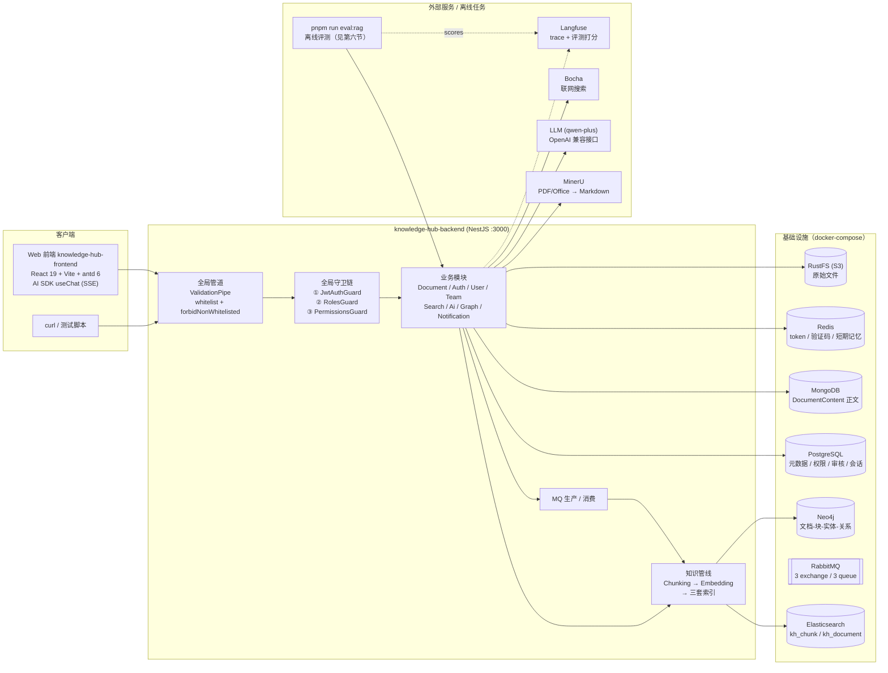
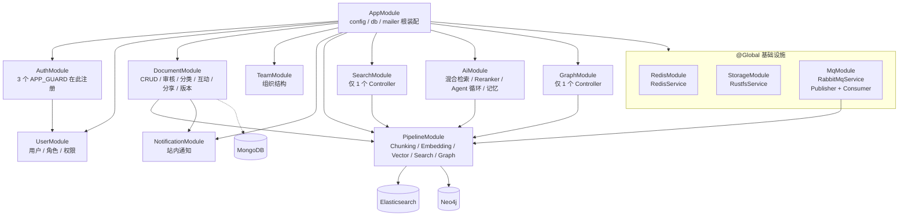
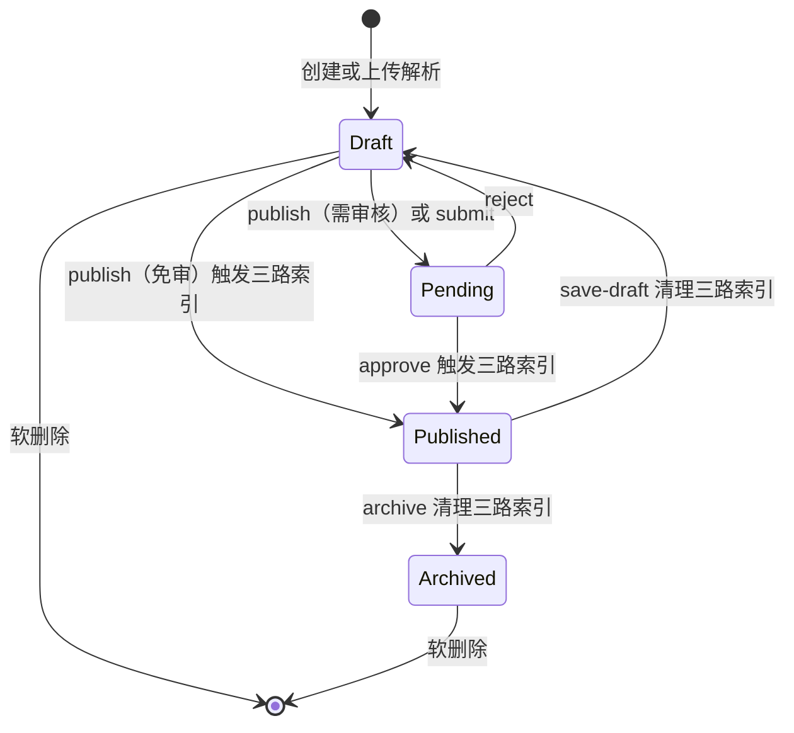
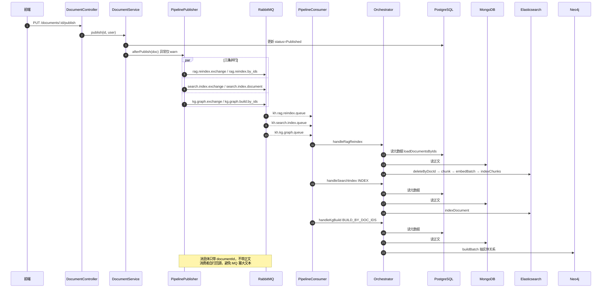
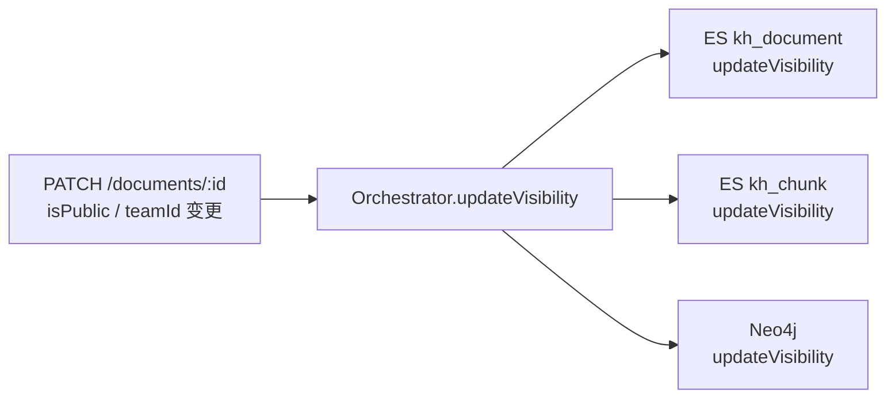
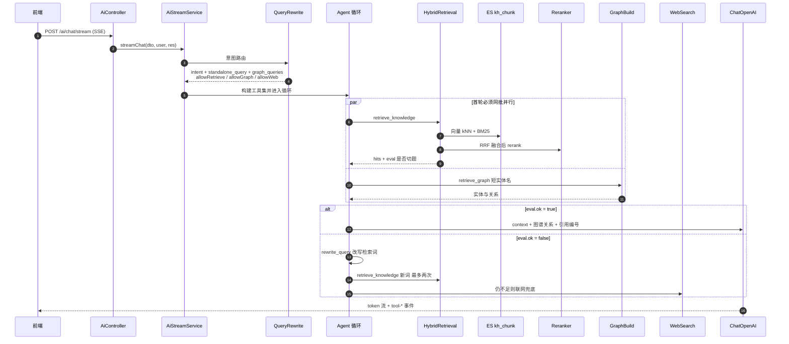
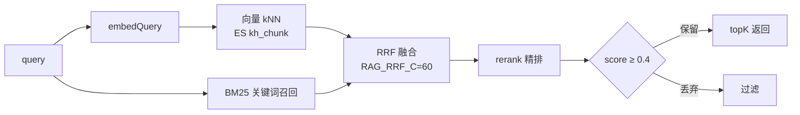
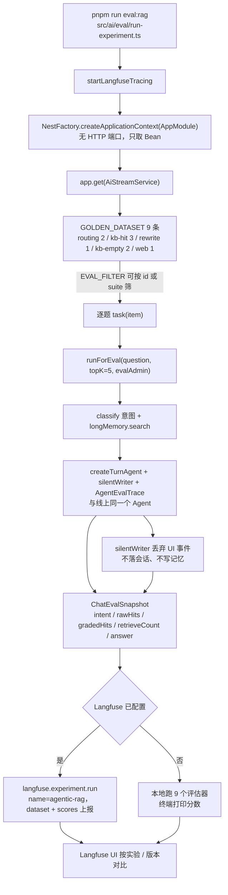
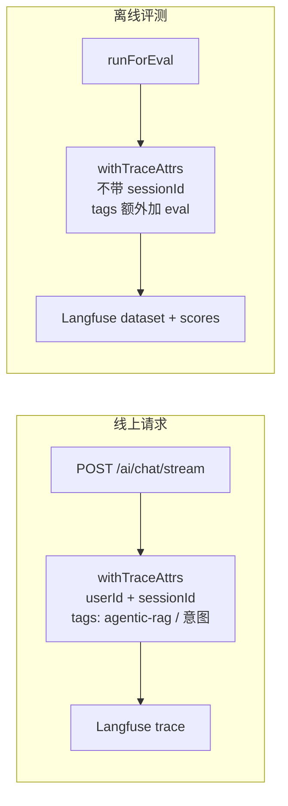
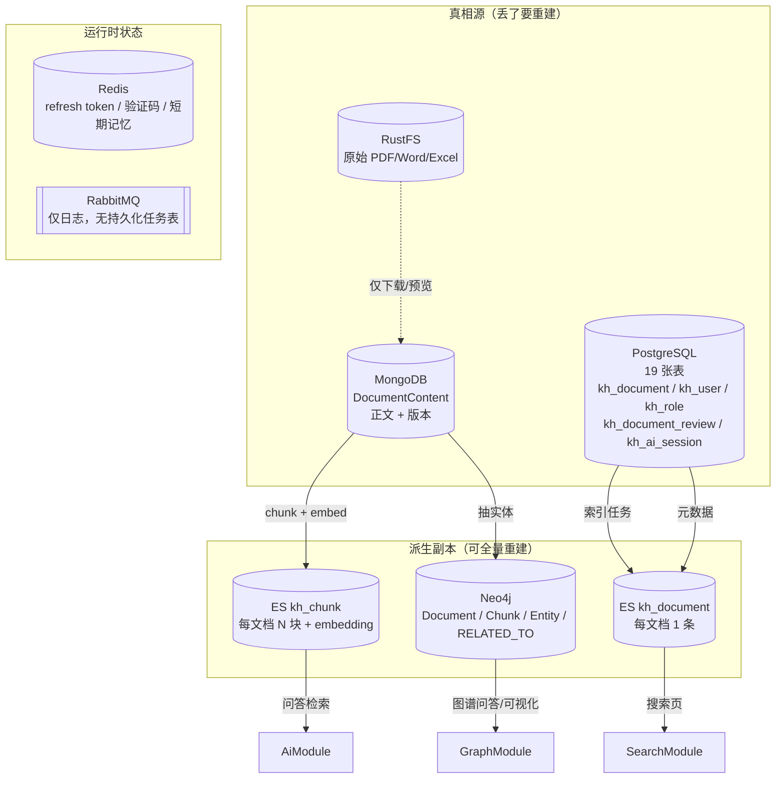

# Knowledge Hub 后端 — 架构与链路图

> 本文的图基于 **CodeGraph v1.6.2** 索引数据（152 files / 2455 nodes / 4805 edges）绘制，
> 第八节路由清单直接取自索引中的 `route` 节点，行号与当前代码一致。
>
> 文字版设计说明见 [README.md](README.md)，索引/图谱取数细节见 [indexing-graph-retrieval.md](indexing-graph-retrieval.md)。

## 目录

- [一、系统上下文](#一系统上下文)
- [二、模块依赖](#二模块依赖)
- [三、文档生命周期](#三文档生命周期)
- [四、异步索引流水线](#四异步索引流水线)
- [五、Agentic RAG 问答链路](#五agentic-rag-问答链路)
- [六、评测与可观测](#六评测与可观测)
- [七、存储与数据归属](#七存储与数据归属)
- [八、接口清单（按模块）](#八接口清单按模块)
- [九、如何重新生成](#九如何重新生成)

---

## 一、系统上下文



请求的必经顺序：`ValidationPipe`（`forbidNonWhitelisted: true`，多传字段直接 400）→ 三道全局守卫。
守卫通过 `@Public()` 元数据放行，目前只有 6 个接口逃逸（`register / login / refresh / verify-email / password/reset/send-code / password/reset`），外加健康检查 `GET /`。

> 代码位置：`src/main.ts:7-24`（bootstrap：langfuse → ValidationPipe → CORS → listen）

## 二、模块依赖



要点：

- `PipelineModule` 是唯一的索引能力提供者，被 `Document / Mq / Search / Ai / Graph` 五处复用；改索引口径只需动这一处，但**影响面覆盖全部检索入口**。
- `RedisModule / StorageModule / MqModule` 标注 `@Global`，任何模块可直接注入，不需要在 `imports` 里声明。
- `DocumentModule` 与 `MqModule` 是双向关系：Document 用 `DocumentPipelinePublisher` 投递，Mq 的 Consumer 反过来调 `PipelineOrchestrator`。

> 代码位置：`src/pipeline/pipeline.module.ts:15-38`、`src/mq/mq.module.ts:7-17`

## 三、文档生命周期



两个副作用函数的共同点：**异常只记 warn，不回滚文档状态**。

> 代码位置：`src/document/document.service.ts:705-732`（`safePublish` / `safeUnpublish`）

这意味着索引是"尽力而为"的最终一致：`safePublish` 失败时文档已 Published 但搜不到，
只能靠 `BUILD_ALL` 手动重建。这是当前实现最需要补偿机制的位置。

## 四、异步索引流水线

发布 → 三份消息并行投递 → 三个消费者队列 → 三种索引。



删除/归档走同一套拓扑，只是 routing key 变成 `*.delete` / `DELETE_BY_DOC_IDS`：

| 交换机 | routing key（建） | routing key（删） | 队列 |
|---|---|---|---|
| `rag.reindex.exchange` | `rag.reindex.by_ids` | `rag.reindex.delete` | `kh.rag.reindex.queue` |
| `search.index.exchange` | `search.index.document` | `search.index.delete` | `kh.search.index.queue` |
| `kg.graph.exchange` | `kg.graph.build.by_ids` | `kg.graph.delete` | `kh.kg.graph.queue` |

> 代码位置：`src/mq/mq.constants.ts:9-26`、`src/mq/document-pipeline.publisher.ts:35-50`

单篇重建的实际顺序（`handleRagReindex` → `reindexOne`）：先 `deleteByDocId` 清旧块，再 chunk，再批量 embed，最后写 ES，避免重复发布残留脏块。

> 代码位置：`src/pipeline/pipeline.orchestrator.ts:52-76`、`152-187`

轻量分支——只改可见性时不重跑 embedding，直接三路并行改索引字段：



> 代码位置：`src/pipeline/pipeline.orchestrator.ts:82-96`

## 五、Agentic RAG 问答链路

三个入口共用同一套混合检索，区别只在"要不要调 LLM"。



检索打分的固定顺序（`/rag/search` 也走这条，只是不调模型）：



> 代码位置：`src/ai/hybrid-retrieval.service.ts:33-66`

意图路由决定的工具挂载规则：

| intent | retrieve_knowledge | retrieve_graph | web_search |
|---|---|---|---|
| `chitchat` / `profile` | 否 | 否 | 否 |
| `kb` | 是 | 是 | 否 |
| `web` | 否 | 否 | 是 |
| `kb_then_web` | 是 | 是 | 是（库循环结束仍不足时） |

> 代码位置：`src/ai/chat-query-rewrite.service.ts:35-54`、`src/ai/ai-stream.service.ts:230-350`

## 六、评测与可观测

> 这一节是补充的：Langfuse 在本项目里不只是"打个 trace"，它还是**离线评测的裁判台**——9 条金标题跑线上同一条 Agent，9 个评估器打分，分数回写 Langfuse 做版本对比。

### 6.1 为什么它不画在"请求链路"里

评测是**离线批处理**，不是用户请求触发的：入口是 `pnpm run eval:rag`，没有 HTTP 端口，跑完即退出。

```powershell
pnpm run eval:rag                    # 全量 9 条
$env:EVAL_FILTER='kb-hit'; pnpm run eval:rag    # 只跑某个 suite
$env:EVAL_CONCURRENCY=2              # 并发，默认 2
```

所以它不该混在服务端请求链路图里——但它复用线上同一个 `createTurnAgent`，**改检索逻辑会直接改变分数**，属于改动前必看的东西。

### 6.2 评测链路



两种模式共用同一份 `AGENT_EVALUATORS`：有 key 时交给 `langfuse.experiment.run` 托管数据集与打分，没 key 时在本地循环跑完只打印——**离线也能验证改动有没有把分数打崩**。

> 代码位置：`src/ai/eval/run-experiment.ts:29-90`（两条分支）、`src/ai/eval/golden-dataset.ts`、`src/ai/eval/evaluators.ts:385-395`

### 6.3 九个评估器

| 评估器 | 衡量什么 | 判定方式 |
|---|---|---|
| `intent_match` | 意图路由是否命中期望 | 与 `expectedOutput.intent` 精确比较 |
| `tool_policy` | 是否按意图禁用工具（chitchat 不许检索） | 规则校验 |
| `rewrite_loop` | 首轮不切题时是否触发改写重查 | 规则校验 |
| `refusal_quality` | 无答案时是否拒答、有没有编造 | LLM-as-judge |
| `hit_at_5` | top5 是否命中金标文档 | 规则校验 |
| `precision_at_5` | top5 里相关文档占比 | 比例计算 |
| `false_hit` | 空召回题是否误判"切题" | 规则校验 |
| `completeness` | 答案要点覆盖度 | LLM-as-judge |
| `groundedness` | 答案是否有据、不幻觉 | LLM-as-judge |

无金标或无期望时返回 `value: null` + 说明，**不强行给 0 分**，避免把"这题不适用"污染成"这题做错了"。

### 6.4 线上 trace 与评测 trace 的区分



加 `eval` tag 是为了在 Langfuse 里把真人流量和跑分流量分开过滤；不带 `sessionId` 是因为评测没有真实会话。

> 代码位置：`src/observability/langfuse.ts:14-61`（`isLangfuseEnabled` / `startLangfuseTracing` / `withTraceAttrs`）、`src/ai/ai-stream.service.ts:384-420`

### 6.5 这套评测的边界

1. **只有 9 条金标**，`hit_at_5` 这类指标抖动大，一次 0.6 一次 0.8 属正常，别当回归信号用。
2. **三个 judge 指标本身是 LLM 打分**，judge 模型一换分数就变，跨版本比较要先固定 judge 模型与 prompt。
3. **评测走 ADMIN 用户**（`EVAL_USER_ID`），绕过了 ACL——测不出"某团队用户看不到某文档"这类问题，那属于 e2e 测试范畴。
4. **没有 CI 接入**：目前靠人工 `pnpm run eval:rag`，没有基线阈值门禁。

> 通用方法论（离线与线上的分工、评估器选型、badcase 回流闭环、生产告警口径）与本节的对齐情况，见 [EVALUATION.md](EVALUATION.md)。

## 七、存储与数据归属



改数据的注意事项：

1. **文档元数据只存 Postgres**，`kh_document` 只是副本；但可见性字段（`isPublic`/`teamId`）在三套索引上各存一份，**改可见性维度必须四处同步**：`searchIndexService` / `vectorIndexService` / `graphBuildService` / `updateVisibility`。
2. **正文只存 Mongo**（`DocumentContent`），ES 里的 `content` 是索引副本，不要反写。
3. **MQ 没有失败重投队列**，投递失败只有一条 warn 日志，重建靠手动 `BUILD_ALL`。

## 八、接口清单（按模块）

索引共 99 个 `route` 节点，下表整理出 98 条可访问路由（含健康检查），除 `@Public` 标注的 7 条外均需 JWT。文件路径省略前缀 `src/`。

### 认证 `auth/auth.controller.ts`（9）

| 方法 | 路径 | 行 | 鉴权 |
|---|---|---|---|
| POST | `/auth/register` | 25 | @Public |
| POST | `/auth/login` | 32 | @Public |
| POST | `/auth/refresh` | 39 | @Public |
| GET | `/auth/verify-email` | 46 | @Public |
| POST | `/auth/password/reset/send-code` | 52 | @Public |
| POST | `/auth/password/reset` | 59 | @Public |
| POST | `/auth/logout` | 66 | JWT |
| GET | `/auth/me` | 72 | JWT |
| GET | `/auth/reviewer-ids` | 77 | JWT |

### 文档核心 `document/document.controller.ts`（16）

| 方法 | 路径 | 行 |
|---|---|---|
| POST | `/documents` | 43 |
| POST | `/documents/upload/parse` | 51 |
| GET | `/documents` | 87 |
| GET | `/documents/:id` | 179 |
| PATCH | `/documents/:id` | 188 |
| DELETE | `/documents/:id` | 199 |
| PUT | `/documents/:id/publish` | 94 |
| PUT | `/documents/:id/archive` | 101 |
| PUT | `/documents/:id/save-draft` | 108 |
| POST | `/documents/:id/reviews/submit` | 115 |
| GET | `/documents/reviews/tasks` | 71 |
| GET | `/documents/reviews/tasks/pending-count` | 79 |
| GET | `/documents/:id/reviews/current` | 123 |
| GET | `/documents/:id/reviews/history` | 133 |
| POST | `/documents/reviews/tasks/:taskId/approve` | 143 |
| POST | `/documents/reviews/tasks/:taskId/reject` | 161 |

> 路由顺序坑：`reviews/tasks` 必须在 `@Get(':id')` 之前注册，否则被 `:id` 吃掉。

### 文档互动 `document/document-engagement.controller.ts`（11）

| 方法 | 路径 | 行 |
|---|---|---|
| POST | `/documents/:id/likes` | 54 |
| POST | `/documents/:id/favorites` | 61 |
| GET | `/favorites` | 33 |
| GET | `/documents/:id/comments` | 68 |
| POST | `/documents/:id/comments` | 74 |
| DELETE | `/documents/:id/comments/:commentId` | 85 |
| GET | `/documents/:id/shares` | 95 |
| POST | `/documents/:id/shares` | 101 |
| DELETE | `/documents/:id/shares/:shareId` | 112 |
| GET | `/documents/:id/versions` | 122 |
| POST | `/documents/:id/versions/:versionId/restore` | 128 |

### 分类与分享（4 + 2）

| 方法 | 路径 | 文件 | 行 |
|---|---|---|---|
| GET | `/categories/tree` | `document/category.controller.ts` | 22 |
| POST | `/categories` | `document/category.controller.ts` | 31 |
| PUT | `/categories/:id` | `document/category.controller.ts` | 38 |
| DELETE | `/categories/:id` | `document/category.controller.ts` | 44 |
| GET | `/shares/:code` | `document/share.controller.ts` | 20 |
| POST | `/shares/:code/access` | `document/share.controller.ts` | 26 |

### 检索问答 `ai/ai.controller.ts`（8）

| 方法 | 路径 | 行 | 说明 |
|---|---|---|---|
| POST | `/rag/search` | 45 | 混合检索，不调 LLM |
| POST | `/ai/chat` | 53 | Agentic RAG 非流式 |
| POST | `/ai/chat/stream` | 64 | Agentic RAG 流式（SSE） |
| GET | `/ai/sessions` | 75 | 会话分页 |
| POST | `/ai/sessions` | 81 | 新建会话 |
| GET | `/ai/sessions/:id/messages` | 88 | 历史消息 |
| PATCH | `/ai/sessions/:id` | 94 | 重命名 |
| DELETE | `/ai/sessions/:id` | 104 | 删除 |

### 搜索与图谱（1 + 4）

| 方法 | 路径 | 文件 | 行 |
|---|---|---|---|
| POST | `/search` | `search/search.controller.ts` | 15 |
| GET | `/graph/overview` | `graph/graph.controller.ts` | 20 |
| GET | `/graph/search` | `graph/graph.controller.ts` | 33 |
| GET | `/graph/nodes` | `graph/graph.controller.ts` | 43 |
| GET | `/graph/edges` | `graph/graph.controller.ts` | 53 |

### 用户 / 角色 / 权限（13 + 6 + 8）

| 方法 | 路径 | 文件 | 行 |
|---|---|---|---|
| PUT | `/users/me` | `user/user.controller.ts` | 35 |
| GET | `/users/me/stats` | `user/user.controller.ts` | 40 |
| PUT | `/users/password/change` | `user/user.controller.ts` | 45 |
| GET | `/users/page` | `user/user.controller.ts` | 58 |
| GET | `/users/:id` | `user/user.controller.ts` | 64 |
| POST | `/users` | `user/user.controller.ts` | 70 |
| PUT | `/users/:id` | `user/user.controller.ts` | 78 |
| DELETE | `/users/:id` | `user/user.controller.ts` | 84 |
| PUT | `/users/:id/password/reset` | `user/user.controller.ts` | 91 |
| GET | `/users/:id/roles` | `user/user.controller.ts` | 101 |
| PUT | `/users/:id/roles` | `user/user.controller.ts` | 108 |
| GET | `/users/:id/permissions` | `user/user.controller.ts` | 116 |
| PUT | `/users/:id/permissions` | `user/user.controller.ts` | 128 |
| GET | `/roles/list` | `user/role.controller.ts` | 28 |
| GET | `/roles/:id` | `user/role.controller.ts` | 39 |
| POST | `/roles` | `user/role.controller.ts` | 51 |
| PUT | `/roles/:id` | `user/role.controller.ts` | 63 |
| DELETE | `/roles/:id` | `user/role.controller.ts` | 75 |
| GET | `/roles/:id/permissions` | `user/role.controller.ts` | 81 |
| PUT | `/roles/:id/permissions` | `user/role.controller.ts` | 89 |
| GET | `/permissions/list` | `user/permission.controller.ts` | 29 |
| GET | `/permissions/tree` | `user/permission.controller.ts` | 35 |
| GET | `/permissions/page` | `user/permission.controller.ts` | 41 |
| GET | `/permissions/:id/children` | `user/permission.controller.ts` | 47 |
| GET | `/permissions/:id` | `user/permission.controller.ts` | 53 |
| POST | `/permissions` | `user/permission.controller.ts` | 59 |
| PUT | `/permissions/:id` | `user/permission.controller.ts` | 66 |
| DELETE | `/permissions/:id` | `user/permission.controller.ts` | 72 |

### 团队与通知（10 + 5）

| 方法 | 路径 | 文件 | 行 |
|---|---|---|---|
| POST | `/teams` | `team/team.controller.ts` | 29 |
| PUT | `/teams/:id` | `team/team.controller.ts` | 37 |
| DELETE | `/teams/:id` | `team/team.controller.ts` | 44 |
| GET | `/teams/page` | `team/team.controller.ts` | 52 |
| GET | `/teams/mine` | `team/team.controller.ts` | 60 |
| GET | `/teams/tree` | `team/team.controller.ts` | 65 |
| GET | `/teams/:id` | `team/team.controller.ts` | 72 |
| POST | `/teams/:id/members` | `team/team.controller.ts` | 79 |
| DELETE | `/teams/:id/members` | `team/team.controller.ts` | 87 |
| GET | `/teams/:id/members` | `team/team.controller.ts` | 94 |
| GET | `/notifications` | `notification/notification.controller.ts` | 22 |
| GET | `/notifications/unread-count` | `notification/notification.controller.ts` | 35 |
| POST | `/notifications/read-all` | `notification/notification.controller.ts` | 40 |
| POST | `/notifications/broadcast` | `notification/notification.controller.ts` | 46 |
| POST | `/notifications/:id/read` | `notification/notification.controller.ts` | 56 |

### 健康检查（1）

| 方法 | 路径 | 文件 | 行 |
|---|---|---|---|
| GET | `/` | `app.controller.ts` | 10（@Public） |

## 九、如何重新生成

索引已建在 `.codegraph/`（自带 `.gitignore`，不会进版本库）。代码改动后 watcher 会自动增量同步，也可手动：

```powershell
cd e:\ai-study\ai-agent-demo\knowledge-hub-backend
codegraph sync          # 增量
codegraph status        # 看统计
```

导出路由清单（本文第八节的数据来源）：

```powershell
codegraph query documents --kind route --limit 60 --json
codegraph query users     --kind route --limit 60 --json
```

查看某个符号的影响面 / 调用者：

```powershell
codegraph impact PipelineOrchestrator
codegraph callers updateVisibility
codegraph affected      # 改了哪些文件 → 该跑哪些测试
```

查看本文图中的某条链路（一次调用拿到源码 + 调用路径）：

```powershell
codegraph explore "publish 之后三套索引怎么建"
codegraph explore "ai/chat/stream 的 Agent 循环"
```

Mermaid 图在 VS Code / CodeBuddy 里装 Mermaid 预览插件即可直接看；
导出图片需要本机有 mermaid-cli：

```powershell
npx -y @mermaid-js/mermaid-cli -i ARCHITECTURE.md -o architecture-rendered.md
# 会在同目录生成若干 architecture-rendered-1.png ... 并把 md 里的块替换为图片引用
```
