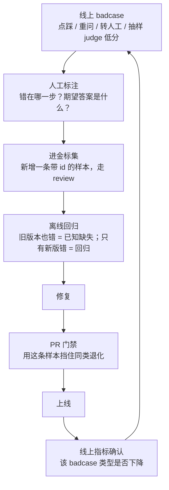

# 评测体系：离线金标与线上监控如何落地

> 本文讲**方法论**：RAG / Agent 类应用在生产里怎么建评测、怎么用评测。
> 本项目具体怎么实现（9 个评测器的判分逻辑、金标怎么写、`pnpm eval:rag` 怎么跑）见 [README 5.9 节](README.md#59-rag-评测pnpm-evalrag)；
> 评测在整体链路中的位置见 [ARCHITECTURE.md 第六节](ARCHITECTURE.md#六评测与可观测)。

一句话结论：**离线评测负责"上线前不退化"，线上评测负责"上线后不偏离"，两者靠 badcase 回流闭环。**

## 一、三层分工

| 层 | 跑什么数据 | 何时跑 | 回答什么问题 | 成本 |
|---|---|---|---|---|
| 离线评测集 | 固定金标集（几十到几百条） | PR / 夜间 / 发版前 | 改动是否破坏了已知能力 | 低，可无限重跑 |
| 线上评测 | 真实流量采样 | 持续 / 每小时聚合 | 真实用户遇到的效果有没有变差 | 中，有 judge 调用费 |
| 人工抽检 | 从上面两层抽 5-10% | 每周 | judge 本身准不准 | 高，占人的时间 |

关键认知：**离线分数是用来「比版本」的，不是用来「看绝对水平」的。**

9 条金标跑出 0.78，不代表系统有 78 分，只代表「和上周那次 0.74 比没退化」。把分数当 KPI 往上汇报，是评测体系烂掉的开始。

## 二、离线评测集怎么落地

### 2.1 数据集是资产，要像代码一样管理

三个来源，重要性递减：

```
人工金标（冷启动 20-50 条）      ← 产品/业务方写，覆盖主路径
线上 badcase 回流（唯一持续增长）  ← 点踩、重问、转人工的会话
合成扩充（从文档反向生成 QA）      ← 只补长尾，绝不作为主证据
```

每条样本至少四个字段：`id`、`input`、`expected`（可空）、`metadata.suite / 难度 / 来源`。

三条纪律：

1. **进 git，改动走 review**。改「期望答案」和改业务代码一样可疑，必须有人看 diff。
2. **合成分要标记来源**。用合成集跑出的高分不能当成绩，它只证明「模型能答自己出的题」。
3. **删样本要写理由**。悄悄删掉一直失败的那条，是最常见的自欺方式。

本项目 `src/ai/eval/golden-dataset.ts` 就是这个结构：TS 常量数组，`metadata.suite` 分 `routing` / `kb-hit` / `rewrite` / `kb-empty` / `web` 五组，`EVAL_FILTER` 可按 id 或 suite 过滤。

### 2.2 指标必须分层，单一总分没有诊断价值

| 层 | 指标 | 失败时定位到哪 |
|---|---|---|
| 检索层 | hit@k、recall@k、MRR、context precision | 召回没拿到 → 查分块 / embedding / ACL 过滤 |
| 生成层 | groundedness（有据）、completeness（要点覆盖）、引用准确率 | 拿到了却答偏 / 幻觉 → 查 prompt / rerank 阈值 |
| 任务层 | 意图路由准确率、tool policy 违反率、拒答正确率 | 工具用错 / 该拒不拒 → 查路由与工具白名单 |

只报一个 end-to-end 分数，等于只知道"病了"但不知道哪里病。分层后任何一个指标掉了，都能直接指到一段代码。

### 2.3 评估器优先用代码，judge 只补代码说不清的

| 类型 | 适用 | 特点 |
|---|---|---|
| 代码断言（精确匹配 / 包含 / 正则 / JSON 字段校验） | 意图、工具策略、hit@k、误召回 | 便宜、零方差、可重复，**能写就必须写** |
| LLM-as-judge（rubric 或 pairwise） | 忠实度、要点覆盖、拒答是否得体 | 有方差，需固定 judge 模型 + `temperature=0` + 结构化输出 |
| 人工抽检 | 校准 judge | 每周 10% 抽样，算 judge 与人的一致率，低于 0.7 就改 judge prompt |

judge 的三条硬要求：

1. **固定模型与 prompt**，版本记进实验 metadata。换 judge 等于换尺子，历史分数全部作废。
2. **强制结构化输出**（Zod / JSON schema），返回 `{verdict, reason}`，不许它自由发挥。
3. **周期性校准**。judge 会漂移，尤其在业务话术变化后。

本项目 9 个评测器里，`intent_match` / `tool_policy` / `rewrite_loop` / `hit_at_5` / `precision_at_5` / `false_hit` 是代码断言，`refusal_quality` / `completeness` / `groundedness` 走 judge（`EVAL_JUDGE_MODEL`，`temperature: 0`）——这个配比是对的：能用规则的绝不交给模型。

另一个细节值得抄：**无金标或无期望时返回 `value: null` + 说明，不强行给 0 分**。否则「这题不适用」会被污染成「这题做错了」，分数失真。

### 2.4 跑法与节奏（落地关键）

| 场景 | 数据集 | 时长 | 门禁 |
|---|---|---|---|
| PR 门禁 | 冒烟集 20 条，只跑代码断言 | < 3 min | 相对基线跌 > 5% 阻断合并 |
| 夜间全量 | 全量 + judge | 20-60 min | 出报告，不阻断 |
| 发版前 | 全量，新旧版本各跑一次 | 约 1 h | 只看 delta，不看绝对值 |

必须守住的一条：**数据集与 judge 固定时，分数才可比。**

所以生产里通常同时保留两份：

- **基线（baseline）**：当前线上版本在同一数据集上的分数快照，跟代码一起版本化。
- **候选（candidate）**：本次改动跑出来的分数。PR 只比这两者的 delta。

## 三、线上评测怎么落地

### 3.1 全量 trace 是地基

线上评测的一切（采样、归因、回放、A/B 归因）都依赖 trace：一条请求要能还原出「问了什么、命中哪些文档、走了哪些工具、生成了什么、耗时多少」。

本项目这一层已经有了：`src/observability/langfuse.ts` 用 OTel + `LangfuseSpanProcessor`，`withTraceAttrs()` 打上 `userId` / `sessionId` / `tags`（`agentic-rag` + 意图），流式链路额外挂 `@langfuse/langchain` 的 `CallbackHandler`。

### 3.2 线上信号分三档，覆盖面和精度成反比

| 档 | 信号 | 覆盖率 | 怎么用 |
|---|---|---|---|
| 显式 | 👍/👎、纠错、转人工、复制答案 | 1-5% | 精度高，直接进 badcase 池 |
| 隐式 | 重问率、同题改写次数、会话轮数、检索为空率、拒答率、首字延迟 | 100% | 覆盖广，只看趋势与突变，不看单条 |
| 抽样 judge | 按 1-5% 采样真实请求，异步打分回写 Langfuse | 1-5% | 得到「线上质量分」时间序列 |

隐式信号里最有用的是**重问率**和**改写率**：用户 30 秒内换个说法再问同一件事，几乎等于一次失败，但用户不会去点踩。这个信号免费、全量、且和真实满意度强相关。

抽样 judge 的做法是异步的：不阻塞响应，把 trace 的 input/output 丢进队列，由 judge 打分后 `createScore` 回写，Langfuse 里就能看到线上质量分的按小时曲线。

### 3.3 灰度与 A/B 比的是业务指标，不是 judge 分

按 `userId` hash 分流 5%，对比的是**解决率、追问率、平均轮数、转人工率**。

judge 分只做辅助监控，因为线上流量结构会变（早高峰问制度、晚上闲聊），judge 分波动比业务指标大得多。

### 3.4 告警看突增，不看均值

```
检索空率      > 基线 2 倍
拒答率        > 基线 1.5 倍
平均输出 token 突变 ±40%
P95 首字延迟   超阈值
judge 均分    连续 3 小时低于基线 10%
```

单项指标轻微抖动会被均值掩盖，但**突增几乎总是线上事故**：索引没建完、模型被切走、配额耗尽、prompt 被改。

## 四、闭环才是目的



没有这条回流的评测集是**一次性快照**：三个月后它测的东西和用户实际在问的东西已经脱节。

业界失败的评测体系，九成死在「数据集不更新」，而不是「指标不够花哨」。

## 五、本项目的现状与差距

| 能力 | 状态 | 证据 |
|---|---|---|
| 离线金标集 | 有，9 条 / 5 suite | `src/ai/eval/golden-dataset.ts` |
| 分层评估器 | 有，9 个（6 规则 + 3 judge） | `src/ai/eval/evaluators.ts` |
| 实验托管与版本对比 | 有 | `langfuse.experiment.run({ name: 'agentic-rag' })` |
| 线上 trace | 有，含 userId / sessionId / tags | `src/observability/langfuse.ts` |
| 线上反馈接口 | **无** | `src` 全量搜索 `feedback` / `thumb` / `rating`，0 命中 |
| 线上抽样 judge | **无** | 仅在离线脚本里调用 judge |
| PR 门禁 / CI | **无** | 靠人工 `pnpm run eval:rag` |
| badcase 回流机制 | **无** | 无反馈入口即无回流起点 |

按投入产出排序，三个动作：

1. **加 `POST /ai/feedback`**：入参 `{ messageId, value: 1 | -1, reason? }`，校验消息归属后写 Langfuse score。
   这是所有线上评测的起点——没有反馈就没有 badcase，没有 badcase 就没有闭环。约 1 小时工作量，收益最大。
2. **金标扩到 30 条**：不要凭空造，从真实使用中的失败里挑。优先补 `kb-hit` 与拒答两类，这两类错得最要命。
3. **把 `eval:rag` 挂进 CI**：只跑 6 个规则类评估器，断言「相对基线跌幅 < 5%」，超过即阻断。judge 指标方差大，只记录不阻断。

## 六、一句话备忘

> 离线集测「已知的坑」，线上监控抓「未知的坑」，人工抽检校准「尺子准不准」，badcase 回流让三者连成一个圈。
> 任何一环断掉，评测就退化成一次性报告。
